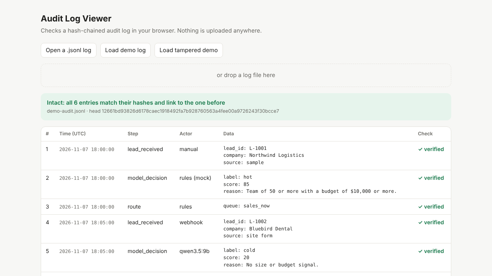

# Verifiable Lead Triage Kit for n8n

An n8n workflow that sorts incoming B2B leads with an AI model (or simple rules) and writes every step to a **tamper-evident audit log**. Each entry carries the SHA-256 hash of the entry before it, so editing, deleting, inserting or reordering a past entry breaks the chain, and the included verifier shows where.



## What's here

| Path | What it is |
| --- | --- |
| `kit/workflow/verifiable-lead-triage.json` | The workflow to import into self-hosted n8n 1.x |
| `kit/verifier/verify_audit.py` | Command-line verifier (Python 3.8+, standard library only) |
| `kit/verifier/viewer.html` | Offline verifier that runs in your browser |
| `kit/samples/` | Demo logs: one intact, one with an edited entry |
| `kit/src/seal.js` | The hashing code used inside the workflow, for review |
| `kit/README.md` | Setup guide (about 10 minutes) |
| `kit/gallery/verifiable-lead-triage.gallery.json` | The same workflow in n8n template-gallery form: settings in an Edit Fields node, overview and section notes |

## Try the verifier in 30 seconds

```
python kit/verifier/verify_audit.py kit/samples/demo-audit.jsonl
python kit/verifier/verify_audit.py kit/samples/demo-audit-tampered.jsonl
```

The first prints `INTACT`. The second reports `line 5: hash does not match the entry's contents (entry was edited)` and exits with code 1.

## Use it

Follow [kit/README.md](kit/README.md): import the workflow, set the log path, run it once in mock mode (no model needed), then verify the log. Any OpenAI-compatible model works for real triage, including local ones (Ollama, LM Studio).

## Gallery version

`kit/gallery/verifiable-lead-triage.gallery.json` runs the same logic, but every value you need to change sits in one **Settings** (Edit Fields) node, and sticky notes explain each section. Environment variables (`AUDIT_LOG_PATH`, `AUDIT_MOCK_LLM`, `AUDIT_LLM_BASE_URL`, `AUDIT_LLM_MODEL`, `AUDIT_LLM_API_KEY`) still override it; API keys belong in the environment, never in the workflow. It is tested with a real n8n run in which the log path comes only from the Settings node (`tests/sandbox_n8n.ps1 -Gallery`).

## Limits

- **Detects, does not prevent:** anyone with write access can still change or delete the file. The log makes changes visible.
- **Full rewrites:** a rewritten file can carry a valid new chain. Keep a copy of the head hash outside the server and check it later with `--expect-head`.
- **Not a correctness check:** the log proves what the model decided and when, not that the decision was right.
- **Not a compliance certification:** it can support your own audit process but does not make you compliant with any standard.
- **Tested on** self-hosted n8n 1.122.4 on Windows. Other platforms are not tested yet; reports are welcome in Issues.

## Development

- `python build_workflow.py` rebuilds the workflow and the viewer from `kit/src/seal.js` and `viewer_template.html`.
- `python -m pytest tests` (needs Node.js) checks that the JavaScript sealer and the Python verifier agree and that tampering is caught.
- `tests/sandbox_n8n.ps1` (Windows, needs the `n8n` CLI) runs the workflow twice in an isolated n8n and verifies the resulting log.

## How this was made

Built with AI assistance (Claude and a local Qwen model) inside an automated company run by its owner, and tested by automated checks, including real runs in n8n, before release.

## Download and support

The same kit is on Gumroad as a pay-what-you-want download with a $0 minimum: https://richterstone3.gumroad.com/l/verifiable-lead-triage-n8n. Paying is optional.

## License

Apache License 2.0. See [LICENSE](LICENSE) and [NOTICE](NOTICE).
